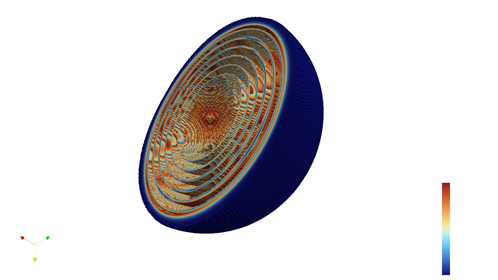

This project was realized for the class _INFO0939-1 - High performance scientific computing_ at the University of Liège, in collaboration with [Loïc Delbarre](https://github.com/Aerozine/). The code is available on [Github](https://github.com/Aerozine/EM-Wave).

While FDTD schemes are a simple and well-known way to simulate electromagnetic waves, they are a good way to learn high-performance computing. In this project, the code was parallelized with OpenMP, MPI, and a CUDA version was implemented, in both 2D and 3D versions. The solver was run on _Nic5_, the computing cluster of the ULiège.

