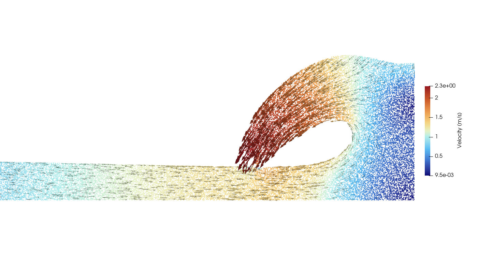
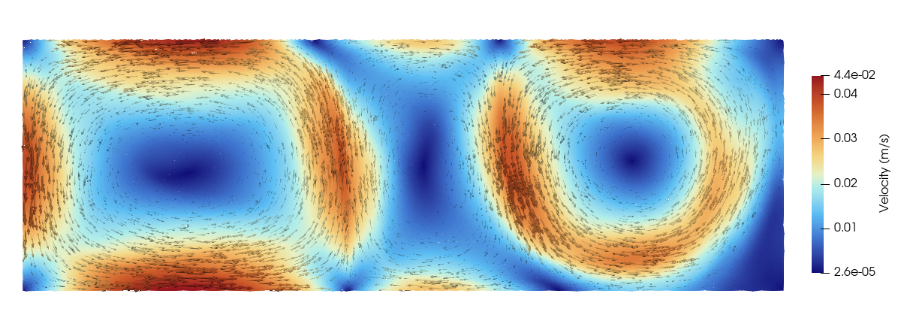

This project was realized for the class _MATH0471-3 - Multiphysics integrated computational project_ at the University of Liège, in collaboration with Néo Collin. You can find the report [here](/files/portfolio/PIC-report.pdf), and the code on [Github](https://github.com/quentin-binstok/PIC).

The particle-in-cell methods consist in splitting the equations into their Lagrangian and Eulerian parts, and solving both one after the other at each time step. The Lagrangian part is solved using virtual particles, which hold no physical meaning, but which allow for an easy computation of the advection, and the application of gravity. The Eulerian part is solved on a finite-differences grid. At each time step, the Eulerian part is solved, the new values are interpolated at the positions of the particles, then the Lagrangian part is solved using the particles, and finally the values are brought back on the grid using a weighting kernel.

The are several ways to handle the particle-grid interaction, leading (among others) to the particle-in-cell method (PIC), the fluid-implicit particle method (FLIP), and the affine particle-in-cell method (APIC), which were implemented in this solver.

We used these methods to solve the Navier-Stokes equations for inviscid fluids, which are

$$
\begin{aligned}
    \frac{\partial \mathbf u}{\partial t} + \mathbf u \cdot \nabla \mathbf u + \frac{1}{\rho} \nabla p &= \mathbf g \\
    \nabla \cdot \mathbf u &= 0
\end{aligned}
$$

with $\mathbf u$ the velocity field, $t$ the time variable, $\rho$ the density of the fluid, $p$ the pressure, and $\mathbf g$ the gravitational acceleration. Thermal effects were included using the Boussinesq approximation. As such, the density was considered to be temperature dependent only in the gravity update. It was also necessary to solve

$$
    \frac{\partial T}{\partial t} + \mathbf v \cdot \nabla T = \frac{r}{\rho c} + \frac{1}{\rho c} \nabla \cdot (k \nabla T)
$$

with $T$ the temperature, $r$ the heat production per unit volume, $c$ the specific heat capacity, and $k$ the coefficient of heat diffusion.

Results were obtained for both internal and free-surface flows. They were compared with theoretical results and experimental data, in order to determine whether the methods gave physical results. It was concluded that the methods gave good physical results, which you can read more about in the report.

Below is the velocity field for a dam-break test.

Rayleigh-Bénard convection was also simulated, and convection cells were observed, as shown below.

